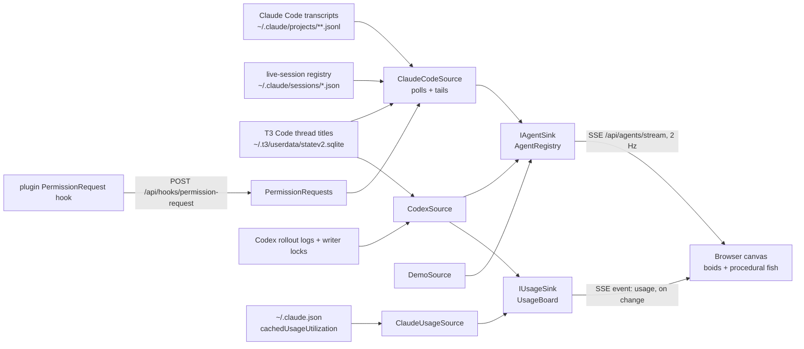

# Agent Aquarium

A live aquarium for **Claude Code and Codex**, in your terminal or T3 Code. Each session is a fish; its subagents swim along as a school. See who is working, who needs you, and how much usage each provider has left.


The aquarium reads local session logs. Your agents need no changes, and it makes no usage API calls.

| Signal | What you see |
|---|---|
| Context size (tokens) | Fish body length, on a square-root scale |
| Working and tool calls | Faster swimming, quicker tail beats and bubbles |
| Turn finished, your move | Gentle swimming near the sand |
| Background work still running | The same gentle swim, without the diver |
| Blocked on your input | An amber glow; the diver comes here first |
| Session and generation | A shared school colour; descendants are darker. Parents have two pale bands and a tall dorsal fin |
| Tool error | A red flash |
| Compaction | A squeeze and burst of bubbles; the fish shrinks |
| Subagent finished | Swims off and fades |

**Two providers, two treasure chests.** The chests labelled **Claude** and **Codex** show what is left of each provider's five-hour limit. Less gold means less remaining usage; the glow turns amber below 30% and red below 10%. Hover either chest for its weekly limit and reset time. Grey means its last report is stale. Each chest appears once its provider has reported a five-hour limit.

Coins float away as that provider's agents spend tokens. This is a price-weighted activity signal, rather than an exact bill: cached input counts less than fresh input, and output counts more. Claude's limit comes from its local usage cache; Codex's comes from the rate-limit reports in its session logs.

**The diver is you.** It swims to whichever agent has waited longest, prioritising agents blocked mid-turn over those whose turn simply finished. Its badge counts who is waiting; hover it for the list. When nobody needs you, it returns to the boat. Background work does not summon it while that work can still wake the agent.

**The Schools list mirrors the tank.** T3 Code sessions use their sidebar titles for both providers. A session without a title shows its repo. Each row adds the provider or host, repo and branch; subagents show their task. Hover a row to highlight its fish, or a fish for context, status and tool activity. Waiting dots glow during active updates and use steady rings in quiet scenes.

Claude Code can report permission prompts through its live-session registry or the optional hook below. Codex's explicit user-input requests also appear as blocked; its permission approvals are not currently recorded in its rollout logs.


## Run

```bash
dotnet run --project src/AgentAquarium --launch-profile live   # your real Claude Code and Codex sessions
dotnet run --project src/AgentAquarium --launch-profile demo   # mixed Claude/Codex demo with synthetic agents and usage
```

Open http://localhost:5180.

To give it a window of its own, install it as an app: in Edge, **⋯ › Apps › Install this site as an app**; in Chrome, **⋮ › Cast, save and share › Install page as app**. The window only has something to show while the server runs.

### Plugin: permission prompts in SDK hosts

In Claude Code, run once:

```
/plugin install agent-aquarium --marketplace guyvdn/AgentAquarium
```

It adds a `PermissionRequest` hook (`plugin/hooks/hooks.json`) that posts each permission prompt to `http://localhost:5180/api/hooks/permission-request`. The aquarium matches it to the tool call still open in the transcript, and the session shows as blocked until that call's result comes in. No hook fires when a prompt is approved, so an approved long-running command stays amber until it finishes. CLI sessions ignore the hook: the live-session registry already reports their prompts, approvals included. The hook never answers the prompt, and when the aquarium is not running the post fails quietly. Running on another port? Change the URL in the hook. Needs Claude Code 2.1.275 or later.

### Settings

Settings are in `src/AgentAquarium/appsettings.json`:

- `Sources:Codex:Enabled` (default `true`): watch Codex sessions alongside Claude Code. `SessionRoots` defaults to `$CODEX_HOME/sessions`, or `~/.codex/sessions`. Add another profile's `sessions` folder to watch it too. The source tails rollout JSONL logs for context size, tool calls, questions, compaction and turn completion; native subagents join their parent's school. Internal permission-review (guardian) sessions are hidden. Codex IDs are prefixed so the two sources cannot collide.
- `Sources:Codex:PollInterval` (default 1 s) and `LookBack` (30 min): writer locks in the profile's `thread-writer-locks` folder keep open sessions visible even when idle, and released locks remove them. T3 Code's shared Codex server holds the lock of every conversation it has loaded, so there T3 Code's state decides instead (see `T3StateFile`). When no usable lock exists (including macOS), recent transcript writes are the fallback. Old Codex versions without turn-completion events may show working until the tank's stall timeout. Permission approvals are not reported by the rollout log, so those do not yet turn a Codex fish amber. Explicit user-input tool calls do.
- `Sources:Codex:T3StateFile` and `T3PollInterval` work like the Claude Code settings below, independently: Codex sessions in T3 use the sidebar title and show `T3 Code · Codex` beneath it. A Codex session leaves the tank once its T3 thread is deleted, archived, or idle and either settled, a finished subagent, or moved to another provider; an idle thread that waits on you stays. Spend from a resumed turn still counts, even when its log is read before T3 Code's state says it resumed. The Codex chest uses the five-hour and weekly `rate_limits` in `token_count` events from recent rollout logs, including recently closed sessions. Its coins follow new token growth, price-weighted like Claude’s, with replayed history excluded. Each provider keeps its own latest report; an older Codex log cannot overwrite a newer report.
- `Sources:ClaudeCode:ProjectRoots`: transcript folders. The default is `~/.claude/projects`. Add another profile's `projects` folder to watch it too.
- `Sources:ClaudeCode:LookBack`: fallback only. A session is shown while its process runs, according to Claude Code's live-session registry (`<config>/sessions/<pid>.json`, checked against the process start time because pids get reused). If that registry is missing (older Claude Code), sessions whose transcript changed within this window are shown instead.
- `Sources:ClaudeCode:UsageFile`: where the chest's numbers come from, Claude Code's own cache of its `/usage` call (`cachedUsageUtilization`). Default `~/.claude.json`; a profile with its own `CLAUDE_CONFIG_DIR` keeps it at `<dir>/.claude.json`. Empty string, or `Sources:ClaudeCode:Enabled=false`, turns the chest off: it only appears once a 5-hour window has been reported. One file is read even when `ProjectRoots` lists several profiles. `UsagePollInterval` (default 10 s) is how often its timestamp is checked; it is only parsed when it changed. The aquarium never calls the usage API itself: that endpoint is rate limited hard and shares its budget with Claude Code, so the numbers are only as fresh as Claude Code's last fetch (roughly every 20 minutes while it runs). Undocumented, checked against Claude Code 2.1.300.
- `Sources:ClaudeCode:T3StateFile`: T3 Code's state database, default `~/.t3/userdata/statev2.sqlite` (T3 Code since 2026-10-20), else `state.sqlite`. T3 Code gives its threads titles of its own instead of Claude's, so a T3 Code session shows the title from its sidebar, found through the Claude session the thread resumes. Opened read-only and re-read every `T3PollInterval` (default 5 s), so a rename shows up too. A session T3 Code has a title for shows as T3 Code wherever it runs, since T3 Code's `worktreesDirectory` setting can put threads anywhere; one resumed in a terminal (`claude --resume`) shows as CLI, under T3 Code's title. Empty string turns it off: T3 Code sessions then show Claude's title, and only those in a `.t3` folder are recognised as T3 Code. The schema is undocumented, checked against T3 Code on 2026-10-20.
- `Sources:ClaudeCode:PollInterval` (default 1 s): how often transcripts and the live-session registry are read.
- `Tank:StallAfter` / `ForgetAfter` / `DoneLinger` (defaults 5 min, 30 min, 20 s): when silent agents turn idle (not while a tool call or background work they started still runs: a build can take many minutes), leave (subagents, and sessions when the live-session registry is missing), and when finished subagents leave. `Tank:ActivityWindow` (60 s) is how far back events count towards swim speed.
- `Sources:Demo:Sessions` (default 3): how many sessions the `demo` profile starts with.

## Rendering and power use

Fish keep swimming while the aquarium is visible. Rendering is capped at **24 fps** after session updates and **12 fps** when quiet; the simulation keeps the same swim speed at either cadence. Unchanged snapshots do not rebuild the Schools list. Quiet waiting dots use steady rings to avoid an extra continuous CSS animation.

Hidden tabs stop scheduling frames and resume from their latest state without replaying missed time. The operating system's `prefers-reduced-motion` setting uses still frames, with live status and hover updates. See [the measured performance results](docs/performance.md), including the continuous-motion measurements.

## Development

```bash
dotnet build && dotnet test          # Meziantou + .NET analyzers (latest-all), warnings are errors
npm install && npm run lint          # ESLint, Stylelint, html-validate for wwwroot
npm run test:js                      # animation and chest regression tests
npm run format                      # Prettier; dotnet format for C#
```

## How it works



- **`Domain/AgentModel.cs`** is the seam. Sources only speak `AgentDescriptor` (identity, parent, depth) and `AgentObservation` (context, tool call, error, compaction, status). Nothing downstream knows about Claude Code.
- **`Sources/ClaudeCode`**: `ClaudeCodeSource` reads `<session>.jsonl` for the main agent and `<session>/subagents/agent-<id>.jsonl` plus `.meta.json` for subagents. A subagent's parent is the agent whose transcript contains the spawning `tool_use` id, so nesting deeper than one level works without special cases. Context = `input + cache_read + cache_creation + output` tokens of the latest assistant message; spend is the same usage price-weighted, counted once per message id and only while it is new (replayed history spends nothing). The transcript format is undocumented (checked against Claude Code 2.1.300), so the parser ignores whatever it does not recognise. `LiveSessions` reads the registry that says which sessions still run and whether they wait on you; `PermissionRequests` hands the plugin's posts over to the source, which matches each to an open tool call (see the `plugin-hooks` skill). `T3ThreadTitles` reads T3 Code's thread titles by Claude session id. `ClaudeUsageSource` reads the chest's numbers.
- **`Sources/Codex`**: `CodexSource` tails `sessions/**/*.jsonl`, checks writer locks for session lifetime, and reads T3 titles and finished threads by native Codex thread ID; for T3 Code, the finished threads override the locks its shared server keeps. `CodexTranscript` maps known rollout events onto the same source-neutral observations. The local format is undocumented; checked against the installed Codex logs on 2026-10-26.
- **`Tank/AgentRegistry`** holds state, derives activity and staleness, and prunes. **`Tank/UsageBoard`** holds the latest usage report for each source; an older one never replaces a newer report from that source.
- **Endpoints**: `/api/agents/stream` (SSE: `snapshot` every 500 ms, `usage` per source on connect and on change), `/api/agents`, `/api/usages` (all provider reports), and the legacy `/api/usage` (latest single report, `204` before any usage is known), and `POST /api/hooks/permission-request` for the plugin.
- **`wwwroot/js`** is plain ES modules on Canvas 2D, with no build step. Static files are served `Cache-Control: no-cache`, so a reload always picks up a changed module. `main.js` runs the loop, the Schools list and the tooltips, `fish.js` handles steering and drawing, `scenery.js` the water, `chest.js` the treasure chest, `diver.js` the diver, `colors.js` the session hue × generation tone. The page is installable through `manifest.webmanifest` and `icons/`.

### Adding a source

Implement a `BackgroundService` that calls `IAgentSink.Upsert` / `Observe` / `Remove`, and register it in `Program.cs`. `DemoSource` is the minimal example. Use `Source` on the descriptor to say where an agent came from. For a push-based source (hooks, OpenTelemetry, another tool's webhook), add an endpoint that maps the payload onto the same sink calls. A source that knows plan usage reports it to `IUsageSink`.

## Support

If Agent Aquarium is useful to you, you can [buy me a coffee on Ko-fi](https://ko-fi.com/guyvdn).

## License

[MIT](LICENSE)
