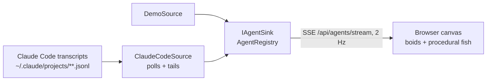

# Agent Aquarium

A live aquarium of your AI coding agents. Each session is a school of fish: the parent leads, its subagents swim with it.


| Signal | Fish |
|---|---|
| Context size (tokens) | Body length (sqrt scale) |
| Activity (working, tool calls/min) | Swim speed, tail beat, bubbles |
| Waiting for you | Slow drift near the sand |
| Generation | Hue = session; each generation is less saturated and darker. Parents also glow, wear two pale bands and a tall dorsal fin |
| Tool error | Red flash |
| Compaction | Squeeze + burst of bubbles; the fish shrinks |
| Subagent finished | Swims off and fades |

## Run

```bash
dotnet run --project src/AgentAquarium --launch-profile live   # your real Claude Code sessions
dotnet run --project src/AgentAquarium --launch-profile demo   # synthetic agents, for working on the visuals
```

Open http://localhost:5180. Settings are in `src/AgentAquarium/appsettings.json`:

- `Sources:ClaudeCode:ProjectRoots`: transcript folders. The default is `~/.claude/projects`. Add another profile's `projects` folder to watch it too.
- `Sources:ClaudeCode:LookBack`: fallback only. A session is shown while its process runs, according to Claude Code's live-session registry (`<config>/sessions/<pid>.json`, checked against the process start time because pids get reused). If that registry is missing (older Claude Code), sessions whose transcript changed within this window are shown instead.
- `Tank:StallAfter` / `ForgetAfter` / `DoneLinger`: when silent agents turn idle, leave, and when finished subagents leave.

## Development

```bash
dotnet build && dotnet test          # Meziantou + .NET analyzers (latest-all), warnings are errors
npm install && npm run lint          # ESLint, Stylelint, html-validate for wwwroot
npm run format                       # Prettier; dotnet format for C#
```

## How it works



- **`Domain/AgentModel.cs`** is the seam. Sources only speak `AgentDescriptor` (identity, parent, depth) and `AgentObservation` (context, tool call, error, compaction, status). Nothing downstream knows about Claude Code.
- **`Sources/ClaudeCode`** reads `<session>.jsonl` for the main agent and `<session>/subagents/agent-<id>.jsonl` plus `.meta.json` for subagents. A subagent's parent is the agent whose transcript contains the spawning `tool_use` id, so nesting deeper than one level works without special cases. Context = `input + cache_read + cache_creation + output` tokens of the latest assistant message. The transcript format is undocumented (checked against Claude Code 2.1.300), so the parser ignores whatever it does not recognise.
- **`Tank/AgentRegistry`** holds state, derives activity and staleness, and prunes.
- **`wwwroot/js`** is plain ES modules on Canvas 2D, with no build step. `fish.js` handles steering and drawing, `scenery.js` the water, `colors.js` the session hue × generation tone.

### Adding a source

Implement a `BackgroundService` that calls `IAgentSink.Upsert` / `Observe` / `Remove`, and register it in `Program.cs`. `DemoSource` is the minimal example. Use `Source` on the descriptor to say where an agent came from. For a push-based source (hooks, OpenTelemetry, another tool's webhook), add an endpoint that maps the payload onto the same sink calls.

## License

[MIT](LICENSE)
