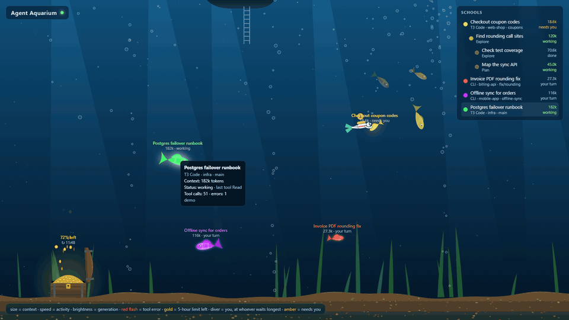
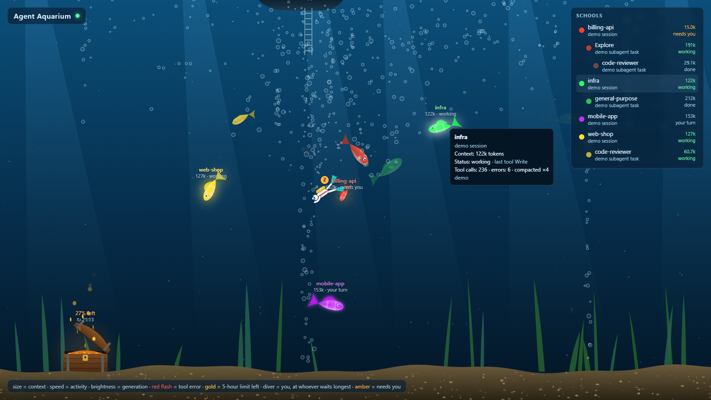
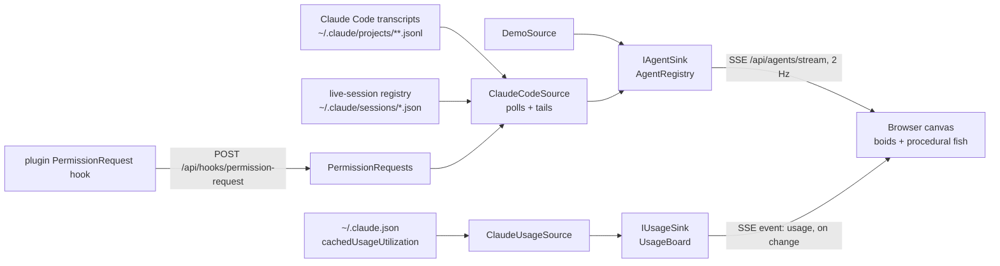

# Agent Aquarium

A live aquarium of your AI coding agents. Each session is a school of fish: the parent leads, its subagents swim with it.



| Signal | Fish |
|---|---|
| Context size (tokens) | Body length (sqrt scale) |
| Activity (working, tool calls/min) | Swim speed, tail beat, bubbles |
| Turn finished, your move | Slow drift near the sand |
| Blocked mid-turn on you (permission prompt, question, plan approval) | Same, with a pulsing amber glow |
| Generation | Hue = session; each generation is less saturated and darker. Parents also glow, wear two pale bands and a tall dorsal fin |
| Tool error | Red flash |
| Compaction | Squeeze + burst of bubbles; the fish shrinks |
| Subagent finished | Swims off and fades |

The treasure chest on the sand is your plan's **5-hour limit**: the gold is what is left, the lid opens as far as there is gold to show, and spending lets coins float away. It glows amber below 30% and pulses red below 10%; when the window resets it refills with a burst. Grey means the numbers are old (over 30 minutes, or the window has reset since). Hover it for the weekly limit too.

The diver is **you**. It swims to whichever agent has waited on you longest, agents blocked mid-turn before ones that merely finished, and climbs back up the boat's ladder when nobody waits. The badge over its head counts who is waiting, amber when one of them is blocked; hover it for the list with how long each has waited. "Blocked" comes from Claude Code's live-session registry (`status: "waiting"`, interactive CLI only) and, for SDK hosts such as T3 Code, from an `AskUserQuestion` or `ExitPlanMode` still unanswered in the transcript. A permission prompt in an SDK host leaves no trace in either: install the plugin below to see those too. Without it, such a session shows as working until it stalls.

Hover a fish for its context, status, last tool, tool calls, errors and compactions. The **Schools** list on the right mirrors the tank: hovering a row lights up its fish, and hovering a fish lights up its row.



## Run

```bash
dotnet run --project src/AgentAquarium --launch-profile live   # your real Claude Code sessions
dotnet run --project src/AgentAquarium --launch-profile demo   # synthetic agents and usage, for working on the visuals
```

Open http://localhost:5180.

To give it a window of its own, install it as an app: in Edge, **⋯ › Apps › Install this site as an app**; in Chrome, **⋮ › Cast, save and share › Install page as app**. The window only has something to show while the server runs.

### Plugin: permission prompts in SDK hosts

In Claude Code, run once:

```
/plugin install agent-aquarium --marketplace guyvdn/AgentAquarium
```

It adds a `PermissionRequest` hook (`plugin/hooks/hooks.json`) that posts each permission prompt to `http://localhost:5180/api/hooks/permission-request`. The aquarium matches it to the tool call still open in the transcript, and the session shows as blocked until that call's result comes in. No hook fires when a prompt is approved, so an approved long-running command stays amber until it finishes. CLI sessions ignore the hook: the live-session registry already reports their prompts, approvals included. The hook never answers the prompt, and when the aquarium is not running the post fails quietly. Running on another port? Change the URL in the hook. Needs Claude Code 2.1.275 or later.

### Settings

Settings are in `src/AgentAquarium/appsettings.json`:

- `Sources:ClaudeCode:ProjectRoots`: transcript folders. The default is `~/.claude/projects`. Add another profile's `projects` folder to watch it too.
- `Sources:ClaudeCode:LookBack`: fallback only. A session is shown while its process runs, according to Claude Code's live-session registry (`<config>/sessions/<pid>.json`, checked against the process start time because pids get reused). If that registry is missing (older Claude Code), sessions whose transcript changed within this window are shown instead.
- `Sources:ClaudeCode:UsageFile`: where the chest's numbers come from, Claude Code's own cache of its `/usage` call (`cachedUsageUtilization`). Default `~/.claude.json`; a profile with its own `CLAUDE_CONFIG_DIR` keeps it at `<dir>/.claude.json`. Empty string, or `Sources:ClaudeCode:Enabled=false`, turns the chest off: it only appears once a 5-hour window has been reported. One file is read even when `ProjectRoots` lists several profiles. `UsagePollInterval` (default 10 s) is how often its timestamp is checked; it is only parsed when it changed. The aquarium never calls the usage API itself: that endpoint is rate limited hard and shares its budget with Claude Code, so the numbers are only as fresh as Claude Code's last fetch (roughly every 20 minutes while it runs). Undocumented, checked against Claude Code 2.1.300.
- `Sources:ClaudeCode:PollInterval` (default 1 s): how often transcripts and the live-session registry are read.
- `Tank:StallAfter` / `ForgetAfter` / `DoneLinger` (defaults 5 min, 30 min, 20 s): when silent agents turn idle, leave (subagents, and sessions when the live-session registry is missing), and when finished subagents leave. `Tank:ActivityWindow` (60 s) is how far back events count towards swim speed.
- `Sources:Demo:Sessions` (default 3): how many sessions the `demo` profile starts with.

## Development

```bash
dotnet build && dotnet test          # Meziantou + .NET analyzers (latest-all), warnings are errors
npm install && npm run lint          # ESLint, Stylelint, html-validate for wwwroot
npm run format                       # Prettier; dotnet format for C#
```

## How it works



- **`Domain/AgentModel.cs`** is the seam. Sources only speak `AgentDescriptor` (identity, parent, depth) and `AgentObservation` (context, tool call, error, compaction, status). Nothing downstream knows about Claude Code.
- **`Sources/ClaudeCode`**: `ClaudeCodeSource` reads `<session>.jsonl` for the main agent and `<session>/subagents/agent-<id>.jsonl` plus `.meta.json` for subagents. A subagent's parent is the agent whose transcript contains the spawning `tool_use` id, so nesting deeper than one level works without special cases. Context = `input + cache_read + cache_creation + output` tokens of the latest assistant message. The transcript format is undocumented (checked against Claude Code 2.1.300), so the parser ignores whatever it does not recognise. `LiveSessions` reads the registry that says which sessions still run and whether they wait on you; `PermissionRequests` hands the plugin's posts over to the source, which matches each to an open tool call (see the `plugin-hooks` skill). `ClaudeUsageSource` reads the chest's numbers.
- **`Tank/AgentRegistry`** holds state, derives activity and staleness, and prunes. **`Tank/UsageBoard`** holds the latest usage report; an older one never replaces a newer one.
- **Endpoints**: `/api/agents/stream` (SSE: `snapshot` every 500 ms, `usage` on connect and on change), `/api/agents` and `/api/usage` (one-off JSON, `204` before any usage is known), and `POST /api/hooks/permission-request` for the plugin.
- **`wwwroot/js`** is plain ES modules on Canvas 2D, with no build step. Static files are served `Cache-Control: no-cache`, so a reload always picks up a changed module. `main.js` runs the loop, the Schools list and the tooltips, `fish.js` handles steering and drawing, `scenery.js` the water, `chest.js` the treasure chest, `diver.js` the diver, `colors.js` the session hue × generation tone. The page is installable through `manifest.webmanifest` and `icons/`.

### Adding a source

Implement a `BackgroundService` that calls `IAgentSink.Upsert` / `Observe` / `Remove`, and register it in `Program.cs`. `DemoSource` is the minimal example. Use `Source` on the descriptor to say where an agent came from. For a push-based source (hooks, OpenTelemetry, another tool's webhook), add an endpoint that maps the payload onto the same sink calls. A source that knows plan usage reports it to `IUsageSink`.

## License

[MIT](LICENSE)
